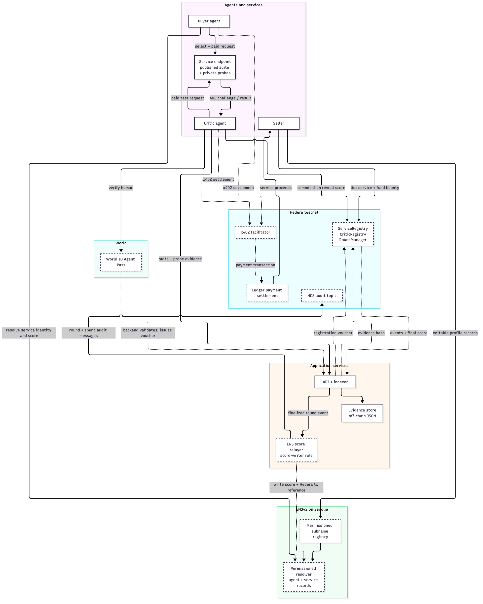

# skeptic

**Incentivised, evidence-backed reviews for agent services.** Skeptic is designed to help buyer agents choose a service based on repeatable tests and stake-backed critic reviews rather than popularity alone.

> **Build status:** this is an in-progress hackathon project. This documentation describes the target flow and marks integrations that still need evidence. In particular, the live Hedera, ENS and World journey is not complete in this checkout. Do not treat the local fixtures as sponsor-network evidence.

## What skeptic does

1. A seller lists an agent service and funds a review bounty.
2. A human verifies through World ID Agent Pass before registering a critic agent.
3. Critic agents pay to exercise a service, run its published test suite, and add private probes to catch overfitting. They commit their scores before revealing them.
4. The round uses a stake-weighted median. Critics close to the median can receive reimbursement and rewards; outliers and non-revealers can be slashed under the configured rules.
5. A relayer mirrors finalized scores to ENSv2 records. Buyer agents use the service identity and score when choosing where to send a paid request.

The median is a measure of critic agreement, not ground truth. See [limits and trust assumptions](#limits-and-trust-assumptions).

## Architecture

The diagram shows the planned end-to-end system. Dashed boxes and edges mark sponsor-network pieces whose live integration still needs to be demonstrated. The current local seed and drill adapters are fixtures; they do not simulate or prove chain settlement, World verification, ENS writes, or HCS publication.



Editable source: [`docs/architecture.mmd`](docs/architecture.mmd).

## Sponsors and protocol role

### Hedera: AI Agents That Pay (x402)

The intended flow uses x402 for paid service calls, with the payment settling on Hedera. The critic and buyer clients should discover a service, enforce their configured spending limits, and complete a paid request without a person approving the ordinary path. Hedera contracts hold listings, stakes, rounds and rewards; HCS is intended to provide a tamper-evident audit stream.

**Live payment evidence:** pending ticket 27. No Hedera transaction ID or HashScan link is available in this checkout, so none is claimed here. Add the transaction ID and HashScan link from the committed ticket 27 evidence before submission. A local fixture run is not payment evidence.

### ENS: Best Use of ENSv2

ENS is intended to be part of how agents and services are named and how buyers resolve their profiles and scores. Service and critic subnames provide portable identities; seller-editable profile records and relayer-written review records use distinct permissions. The buyer flow is meant to read these records through an ENSv2 resolver rather than display constants embedded in the UI. Removing ENS would remove the name-to-profile and name-to-score lookup that connects marketplace choices to the agents and services being reviewed.

The feature-by-feature implementation and evidence status are in [`docs/ens.md`](docs/ens.md). ENSv2 addresses and a live resolver-read link are pending the ENS spike and ticket 27 evidence.

### World: World ID Agent Pass

Agent Pass is intended to gate the meaningful action of registering a critic, limiting one critic identity per verified person. The backend must validate the result before issuing a registration voucher. A denied, expired, cancelled, or duplicate-human attempt must not register a critic. This is an authorization step, not a login decoration. The complete verified and denied journeys remain to be demonstrated against the official integration.

## Payment and review flow

The planned paid call is: critic or buyer selects a listed service; the client checks its price against the caller's spending policy; x402 obtains payment for the request; the service returns its result; and the Hedera transaction ID is recorded with the run evidence. For critic runs, evidence is stored off-chain and its hash is committed on-chain. HCS is intended to carry separate round and spending audit messages. Finalized review data is then mirrored to ENS by the relayer.

This checkout contains no verified live transaction. Ticket 27 is responsible for running and recording the end-to-end test. Once it lands, this section must link the actual settled call, finalization, ENS resolver read, HCS message and unattended buyer payment from that evidence.

## Local setup and verification

From a fresh clone, the intended integration check is:

```sh
git clone https://github.com/anmxlr/skeptique.git
cd skeptique
pnpm install
pnpm -r build
pnpm e2e
```

**This sequence is not yet runnable from this ticket branch.** Ticket 04 has not supplied the root pnpm workspace and application scaffold, and ticket 27 has not supplied the integrated end-to-end flow. Once those land, follow the committed `.env.example` for local configuration; use test credentials only for live-network steps, and never commit `.env` or private keys. Re-run the commands above from a clean clone and replace this status with the exact successful output before claiming the project is ready to run.

The current files include deterministic demo service definitions, probe-generation logic, and a fixture-only seed/drill harness. The harness prints `LOCAL FIXTURE RUN ONLY` by design. It is not wired to Hedera, ENS, World, HCS, or live x402 settlement in this branch.

## Relayer trust compromise

Hedera and Sepolia are separate chains. A relayer listens for finalized Hedera rounds and writes the corresponding score records on ENS Sepolia. The relayer holds the score-writer permission, so it can publish an incorrect or stale ENS value, or stop publishing. The ENS record is therefore a convenient mirror, not a trustless proof of the Hedera result. The intended record includes the source Hedera transaction ID so a reader can independently compare the mirror with Hedera. This design still requires trust that the relayer reports the source correctly; it does not provide cross-chain proof verification.

## Reputation standards

ERC-8004 provides shared agent identity and reputation/validation registries, while HCS-14 describes agent identity/discovery conventions. Skeptic addresses a narrower mechanism: paid service testing, evidence references, commit-reveal scoring, stake-weighted aggregation, and rewards or slashing for critics. It is intended to complement portable identity and reputation standards with a review process; this checkout does not claim a completed ERC-8004 or HCS-14 adapter.

## Limits and trust assumptions

- A stake-weighted median can be wrong. Skeptic does not defend against a majority of stake colluding or all critics sharing the same mistaken belief.
- A seller may bribe real people. World verification limits one critic per human but does not prevent bribery.
- Nondeterministic services can produce inconsistent results and punish honest critics.
- Seller-to-critic test payments can inflate usage metrics. Critic calls must be excluded from popularity counts.
- Commit-reveal reduces copying, but does not make reviewers independent or their evidence truthful.
- The relayer can misreport or censor ENS score updates, as described above.
- Local fixtures and staged demo actors do not establish production security, independent critic participation, or live sponsor integration.

## Third-party software and services

The project-specific review mechanism and demo services are developed in this repository. Current third-party code imports are Ajv (MIT, JSON-schema validation) and Vitest (MIT, tests); Node.js built-ins are also used. Mermaid CLI (`@mermaid-js/mermaid-cli`, MIT) was used to render the committed architecture image and is not a runtime dependency. Versions and transitive dependency licenses must be confirmed from the lockfile once ticket 04 supplies the workspace. Planned external integrations include Hedera/x402 and HCS, ENSv2, and World ID Agent Pass; their final SDK/package names and licenses must also be recorded before release. No sponsor API credentials or private keys belong in this repository.

## Evidence and remaining work

| Evidence | Status in this checkout |
| --- | --- |
| Fresh-clone install, build and end-to-end run | Pending ticket 04 integration and ticket 27 |
| Settled Hedera x402 transaction and HashScan link | Pending ticket 27; none claimed |
| Hedera round finalization and HCS audit message | Pending ticket 27; none claimed |
| ENSv2 record read through the resolver | Pending ENS integration and ticket 27; none claimed |
| World Agent Pass success and denied path | Pending integrated World flow; local fixtures are not proof |
