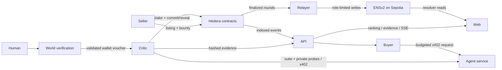

# skeptique

**Incentivised, evidence-backed reviews for agent services.** Buyer agents choose services using paid tests, private probes and stake-backed critic agreement instead of popularity alone.

**Live app:** https://skeptique.vercel.app/

> Hackathon MVP. The local review, contract, API and web flows are implemented. Individual Hedera, ENS and World integrations have recorded live evidence; the complete sponsor-network journey remains pending ticket 27. Rewards, non-revealer penalties and failed-round recovery remain unfinished.

## How it works

1. A seller lists a service, publishes its test suite and locks a listing fee as a review bounty. Listing automatically opens its first review round.
2. A person completes World verification. The backend validates the proof and issues a wallet-bound voucher; a critic registers with stake.
3. Critics run the public suite and independent private probes. The combined review weights public results 40% and probes 60%. Evidence is published by hash; critics commit before revealing scores.
4. RoundManager computes a stake-weighted median, marks critics within tolerance as honest and slashes outliers. Committed stake stays locked until successful finalization and cannot back concurrent rounds.
5. The API indexes listings, rounds and evidence. It ranks reviewed services using reveal count and age; unreviewed services remain on probation. SSE streams round changes to the service page.
6. A role-limited relayer publishes finalized review snapshots to ENSv2. The web reads published scores through the resolver. Buyer agents can select services and make budget-controlled x402 calls.

Agreement is not ground truth. Critic rewards and reimbursements are part of the intended incentive system, but are not paid by the current contracts.

## What is implemented

| Component | Current behavior |
| --- | --- |
| `contracts/` | Listings and bounties; voucher-backed critic registration; stake custody and locking; commit/reveal; weighted median; outlier slashing; automatic first round and funded-service checks. |
| `apps/critic/` | Suite verification/execution, private probes, combined evidence and persisted commit/reveal recovery. Orchestration is exercised by local tests; a complete unattended production scheduler is still needed. |
| `apps/api/` | Live-chain sources for listings, ranking, critics and rounds; review evidence validation; round timelines; `/events`; `/deployment`; server-validated World onboarding. Evidence and onboarding nonce storage are currently in memory. |
| `apps/web/` | Marketplace, service evidence and timeline, live latest-round panel, ENS profile/score reads, seller listing, critic onboarding and buyer comparison; loading/error/accessibility checks. |
| `apps/relayer/` | ENSv2 service subnames and per-record roles; finalized service scores and critic snapshots; atomic record writes; signed-transaction journal for crash recovery. |
| `packages/x402-client/` | Local HTTP mode plus Hedera x402 payments with price caps and denial hooks. Local mode does not settle payments. |
| `packages/harness/` | Real local EVM deployment, API and optional HTTP services. Separate seed/drill adapters remain explicitly fixture-only. |

See the [integration status](docs/integration-status.md), [deployment guide](contracts/deployments/README.md), [ENS notes](docs/ens.md) and [ranking rationale](docs/research/19-ranking.md).

## Architecture



The relayer is a trusted cross-chain mirror. HCS audit publication, rewards/claims and ERC-8004/HCS-14 adapters are not implemented in this flow. The older [architecture artwork](docs/architecture.png) describes the broader target, including planned components.

## Local setup and checks

Requires Node 20.12+ and pnpm 9.15.0. From a fresh checkout:

```sh
gh repo clone anmxlr/skeptique
cd skeptique
pnpm install --frozen-lockfile
pnpm --filter @skeptique/web exec playwright install chromium
pnpm lint
pnpm build
pnpm test
pnpm e2e
pnpm seed
pnpm drills
```

These checks need no sponsor credentials. End-to-end tests start real local contracts and HTTP services, test persisted critic recovery, evidence, ranking, World denial paths and SSE, and scan a production browser bundle for server secrets. The web suite includes Chromium tests. Run builds, browser tests and the end-to-end suite sequentially: they share the web build directory. The end-to-end suite limits worker concurrency to avoid overwhelming local chain/build startup.

For a staged HTTP-review-to-local-chain settlement check:

```sh
DEV2_EVIDENCE_PATH=/tmp/skeptique-flow.json pnpm e2e
DEV2_EVIDENCE_PATH=/tmp/skeptique-flow.json DEV2_SETTLEMENT_PATH=/tmp/skeptique-settlement.json pnpm settle:local
```

The generated artifacts are local evidence. The settlement script refuses remote networks. `pnpm seed` and `pnpm drills` print `LOCAL FIXTURE RUN ONLY`; they do not prove sponsor integration.

## Run against sponsor networks

Copy `.env.example` to an untracked `.env` and reuse the team's existing keys. Configure the actual RPCs, funded accounts and namespace; never commit keys or put signing secrets in `NEXT_PUBLIC_*` variables. `pnpm env:check` validates the full team configuration, including integrations that may not be needed for one local task.

1. Follow the [Hedera deployment guide](contracts/deployments/README.md). `HEDERA_DEMO_WINDOWS=true pnpm --filter @skeptique/contracts deploy:hedera` deploys and connects all three contracts, then writes the validated public manifest. Deployment requires funded accounts. Normal quorum is three; the local harness uses one for its single-critic recovery scenario.
2. Set `API_PORT`, `HEDERA_RPC_URL` and, if overriding the default manifest, `DEPLOYMENT_PATH`. Set `ENS_PARENT_NAME` and optional `ENS_NAMES_PATH` for names matching registered namehashes. Start `pnpm --filter @skeptique/api start`. Startup rejects the wrong chain.
3. Set `NEXT_PUBLIC_API_URL`, `NEXT_PUBLIC_SEPOLIA_RPC_URL` and `NEXT_PUBLIC_ENS_PARENT_NAME` for the web app. Set the World app/environment public values and backend RP/signing/attestor values for onboarding. Set `WEB_ORIGIN` to the exact browser origin for World POST requests. Start `pnpm --filter @skeptique/web dev`.
4. Configure the ENS namespace using `pnpm --filter @skeptique/relayer ens:setup`. The listing relayer and score publisher use separate commands and permissions; see [ENS notes](docs/ens.md). Run `pnpm --filter @skeptique/relayer scores /absolute/path/to/public-ens-config.json` with a persistent `ENS_TRANSACTION_JOURNAL` outside git. Critic subnames must be provisioned before score publication.
5. Run the relevant `pnpm test:live -t '<test name>'` checks and record actual explorer links. `round on hedera testnet` requires the fresh short-window deployment plus funded seller and three critic keys; it fails explicitly if credentials are missing.

Contract stake/bounty amounts use tinybars (8 decimals). Hedera JSON-RPC transaction `value` uses 18 decimals; the shared conversion helper handles that boundary. API/relayer scans start at the deployment block. Replaying a deployment older than the relay's seven-day log window needs an indexer or bounded historical queries.

## Sponsor evidence

These links are recorded evidence from earlier runs, not claims that the current integrated checkout has completed a new funded rehearsal.

| Integration | Recorded evidence | Remaining |
| --- | --- | --- |
| Hedera x402 | [Settled testnet payment](https://hashscan.io/testnet/transaction/0.0.9185802@1793963896.847912784); [ticket 15 receipt](board/done/15.md) records mirror confirmation and unattended critic payment. | Full review-to-buyer journey, fresh mechanism deployment/finalization and HCS audit evidence. |
| ENSv2 | [Ticket 12 receipt](board/done/12.md): live Sepolia subname creation, resolver score read, seller/profile vs relayer/score permissions and idempotent rerun. | Live publication of finalized Hedera scores using the new score relayer; complete integrated demo. |
| World | [Ticket 16 receipt](board/done/16.md): official staging verification, duplicate-human denial and tampered-proof denial; [integration feedback](WORLD_FEEDBACK.md). | Full real-wallet browser registration rehearsal. Event identities are mocked and do not establish real-human uniqueness. |

Ticket 27 owns the complete integrated evidence run. Tickets 20/21 code is integrated without claiming their still-missing funded acceptance receipts.

## Arena: does Skeptique help a buyer?

`/arena` runs one task through two buyer agents side by side, one without Skeptique and one with it. Both use the same model, prompt and budget, and both pay with real x402 payments on Hedera testnet. A deterministic oracle grades each part. Users can bring their own Hedera testnet and Claude keys.

Across two live must-buy batches (38 paid parts per side, half of them Web3 tasks in HBAR and ETH units):
- **Without Skeptique:** 66% correct, against an expected 64.5%, with 32% of its spend going to wrong answers.
- **With Skeptique:** 100% correct, nothing wasted.

Unit answers link to the page that defines them (NIST, Hedera docs, ethereum.org) and currency answers link to the demo's fixed rate table, and a "made-up check" checks that every number an agent quotes appears in the data it was shown.

Method, expected values, tx links and limits: [docs/arena.md](docs/arena.md).

## Ranking and trust limits

The API computes `confidence = min(1, reveals / 5) × max(0.3, 0.5^(ageDays / 7))` and `rank = median − 15 × (1 − confidence)`. This is a ranking heuristic, not statistical confidence. ENS displays the published snapshot; it does not silently fall back to an API score if resolution fails.

- A majority of stake can collude. Shared model errors, bribes or nondeterministic service outputs can produce wrong scores and unfair slashing.
- Commit/reveal limits copying; it does not prove that evidence is truthful or critics are independent. Sellers can recognize public critic wallets.
- World staging/mock proofs demonstrate the authorization flow, not production human uniqueness. Contract nullifiers are the durable duplicate guard; API nonce/voucher state is in memory.
- The relayer can publish incorrect/stale ENS values or stop. Source transaction references permit comparison with Hedera; they are not cross-chain proofs.
- Too-few-reveal rounds currently cannot finalize or release locked collateral. Rewards, reimbursement, claims and non-reveal penalties await their owning tickets. Listing bounties are locked but are not yet distributed.
- Evidence disappears when the API process restarts. Long-running indexing, durable storage and an unattended critic scheduler remain deployment work.
- Demo critics are team-run. Local tests and fixture drills do not establish production security or independent participation. See the web app's `/limits` page.

## Dependencies and contributing

The committed `pnpm-lock.yaml` is authoritative. Main dependencies include viem, Hardhat, Fastify, Zod, Ajv, canonicalize, Next.js/React, World IDKit and the x402 Hedera stack. Tests use Vitest, fast-check, Mocha, Playwright and axe. Code is [MIT licensed](LICENSE); dependency licenses remain their own.

Use new branches from current `main` and separate follow-up PRs. Preserve history with normal merges; do not squash or force-push. Delete a completed remote branch only after its tip is reachable from `main`. Ticket completion still requires its acceptance evidence. See [integration notes](docs/integration-status.md) and [AI usage](AI_USAGE.md).

## Contributors

Human contributors are listed in the [GitHub contributor history](https://github.com/anmxlr/skeptique/graphs/contributors).

**OpenAI Codex — AI development contributor:** assisted with implementation, code review, integration fixes, testing, and documentation. Ticket receipts and [AI_USAGE.md](AI_USAGE.md) document AI assistance across the project.
